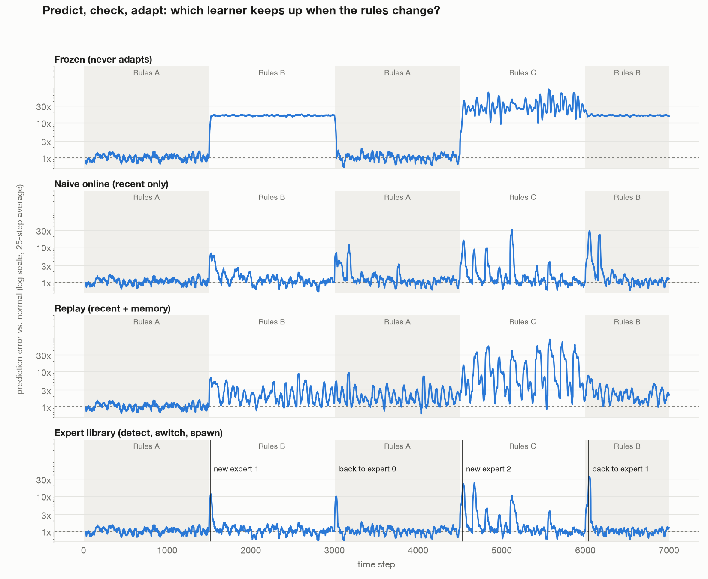
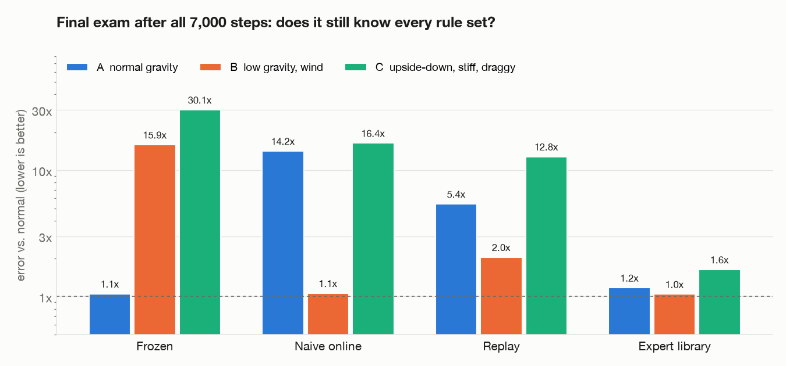

# Continual learning experiments

Can a learner keep picking up new things without losing what it already knows?
This repo holds a series of small, honest experiments on that question, from a
1.7B language model on a laptop to tiny creatures in browser worlds, plus a
fact-checked literature review.

Everything runs on an Apple M1 Max (32 GB). The language-model work uses
[MLX](https://github.com/ml-explore/mlx) and `Qwen/Qwen3-1.7B`.

## Summary

| # | Experiment | Main finding |
|---|---|---|
| 1 | LoRA on 25 invented facts | All facts learned; general knowledge kept only with enough replay and a gentler learning rate |
| 2 | Ten rounds of new facts | Naive stacking forgets every older fact; replay keeps about half; general knowledge erodes in both |
| 3 | Online world model under changing physics | A library of experts gated by surprise is the only learner that keeps all three rule sets |
| 4–7 | Browser habitats | Surprise-driven memory, planning and learned movement cut deaths sharply |
| 8–9 | Social habitat, winters, deadly poison | Winter planning halves starvation; learning from others helps only a little, and only when recognition is reliable |
| 10 | Senses | A no-pretraining mind links sounds to sights in a demo world (15 of 16 predictions right) |

The literature review is in [`review/`](review/README.md): five research angles,
each fact-checked against the sources (136 findings, none refuted), with a
proposed experiment to test the main open gap.

## Layout

    llm/         Experiments 1–2: data, LoRA configs, training rounds, evaluation, results, chat page
    worldmodel/  Experiment 3: physics world, learners, results and charts
    habitat/     Experiments 4–9: single-file browser habitats and a headless runner (Node)
    senses/      Experiment 10: React app, engine in src/engine
    review/      Literature review and per-claim notes

## Setup

    uv sync              # Python 3.12, MLX, mlx-lm, numpy, matplotlib
    # habitats: any browser; headless runs need Node 20+
    # senses: Node 20+, npm

Model weights download from Hugging Face on first use. Adapters and per-round
training data are regenerated by the scripts and are not committed.

## Experiment 1: teaching a 1.7B model new facts with LoRA

Folder `llm/`.

Teach Qwen3 1.7B new facts with a LoRA adapter on an M1 Max, and check what it forgets.

### Data
- 25 made-up facts about a fictional town, Velmora (`facts.py`). Each has 3 training questions and 1 unseen test question.
- 25 general questions the base model already answers (`general.py`). Never trained on.
- Replay: 30 other general questions answered by the base model itself, mixed into training.

### Results
| Run | Facts, trained wording | Facts, new wording | General knowledge kept |
|---|---|---|---|
| Base model | 0/25 | 0/25 | 25/25 |
| v1: 24 replay rows, lr 1e-4, 100 steps | 25/25 | 24/25 | 20/25 |
| v1: same, 300 steps | 25/25 | 25/25 | 21/25 |
| v2: 60 replay rows, lr 5e-5, 200 steps | 25/25 | 25/25 | 25/25 |

v1 forgot things and leaked Velmora into unrelated answers, e.g. "the Red Planet is Velmora".
v2 fixed that with more replay and a gentler learning rate.

### Rerun
    cd llm
    uv run python build_data_v2.py
    uv run python -m mlx_lm lora -c lora-v2.yaml
    uv run python evaluate.py adapters/v2 lora-v2

### Limits
- Small test sets, scored by keyword match.
- The v2 validation set holds only fact rows, so its validation loss means little.
- One training round. Repeated rounds are where forgetting usually builds up.

## Experiment 2: ten rounds in a row

One new made-up town per round, 10 facts each, adapter carried forward. 100 steps per round, lr 5e-5.
Every round also replays the same 30 general answers from the base model.
- naive: new town only.
- replay: new town plus 30 rows sampled from earlier towns.

Scores use unseen question wording. Older = towns from earlier rounds.

| Round | Naive: older towns | Naive: general | Replay: older towns | Replay: general |
|---|---|---|---|---|
| 1 | - | 25/25 | - | 25/25 |
| 2 | 0/10 | 23/25 | 10/10 | 23/25 |
| 3 | 0/20 | 21/25 | 17/20 | 22/25 |
| 4 | 0/30 | 19/25 | 24/30 | 22/25 |
| 5 | 0/40 | 22/25 | 28/40 | 20/25 |
| 6 | 0/50 | 19/25 | 40/50 | 19/25 |
| 7 | 0/60 | 21/25 | 35/60 | 16/25 |
| 8 | 0/70 | 17/25 | 37/70 | 17/25 |
| 9 | 0/80 | 18/25 | 39/80 | 13/25 |
| 10 | 0/90 | 11/25 | 43/90 | 15/25 |

The newest town scored 10/10 in every round of both runs except replay round 3, which scored 8/10.

Findings
- Naive overwrites: 85 of 90 final misses answered with another town's value.
- Replay keeps about half of older facts after ten rounds, versus none.
- General knowledge erodes in both runs, e.g. "the capital of Japan is Canberra".
  Replaying the same 30 general answers was enough for one round but not for ten.

Run from `llm/`: `uv run python rounds.py naive|replay 10 100`. Per-round logs are in `llm/runs/*/log.json`. Run one training at a time: two at once hung the M1 Max GPU.
Caveat: general answers are cut at 40 tokens, which can undercount slightly.

Ideas for experiment 3
- Fresh general replay each round, from new questions answered by the base model.
- Penalise drift from the base model's outputs, called distillation or KL regularisation.
- Retrain from the base model each round on all facts so far, instead of stacking updates.
- A memory layer that looks up facts, as the comparison baseline.

## Chat page
    cd llm && ./chat.sh
Then open http://localhost:8090. Pick the plain model or any trained adapter from the Model menu.
Tick Thinking to see Qwen3's reasoning. Stop it with Ctrl+C in that terminal, or `pkill -f chat.sh; pkill -f 'mlx_lm server'; pkill -f 'http.server 8090'`.

## Experiment 3: a world model that predicts, checks and adapts

Folder `worldmodel/`. A small neural network (4 inputs, two layers of 64, 4 outputs) watches a ball on a spring
and predicts where it will be one moment later. Then it sees what really happened and may learn from it.
The rules change without warning. It runs on the CPU in under a minute.

Rule sets (`world.py`): A normal gravity; B low gravity plus wind; C upside-down gravity, stiff spring, heavy drag.
Sensors add small noise, so a perfect model still has a little error. Every model starts pretrained on A.
Schedule: A 1500 steps, B 1500, A again 1500, C 1500, B again 1000.

Learners (`learners.py`), all predicting before they see the outcome:
- Frozen: never learns after pretraining.
- Naive online: one learning step per moment on the last 32 moments.
- Replay: 16 recent moments plus 16 drawn from a memory of everything seen.
- Expert library: one small expert per rule set. A moment the active expert finds surprising
  (error above 6x normal) is never used to train it. When 15 of the last 20 moments are surprising,
  it reuses an old expert that fits, or spawns a new one.

Errors are multiples of the pretrained model's normal error on A; 1x is as good as it gets.

| Learner | A | B | A again | C | B again | Final exam: A / B / C |
|---|---|---|---|---|---|---|
| Frozen | 1.0 | 15.9 | 1.0 | 31.2 | 15.9 | 1.1 / 15.9 / 30.1 |
| Naive online | 1.1 | 1.4 | 1.5 | 2.3 | 2.6 | 14.2 / 1.1 / 16.4 |
| Replay | 1.0 | 2.6 | 2.2 | 14.4 | 2.5 | 5.4 / 2.0 / 12.8 |
| Expert library | 1.0 | 1.3 | 1.2 | 2.4 | 2.0 | 1.2 / 1.0 / 1.6 |

The final exam tests each learner after all 7,000 steps on fresh data from every rule set.

Findings
- The expert library made exactly 3 experts. It spotted B 16 steps after it began and C 33 steps after.
  It recognised the returning rules and switched back to the old experts, at steps 3015 and 6041.
- Only the library still knows all three rule sets at the end. Naive online keeps only the latest rules.
- Replay did worst while live: one network trying to fit three different rule sets at once fits none well.
- Cost of the library: about 20 to 40 steps of high error at each change while it decides,
  and a short learning period for each new expert.

Rerun: `cd worldmodel && uv run python run.py && uv run python analyse.py && uv run python plot.py`

Caveats
- One run, one seed, a simple world. The rule sets are very different, so changes are easy to detect.
  Subtle or gradual changes would be harder.
- Thresholds were tuned on this same run: 6x surprise, 15 of 20 moments, online learning rate 3e-4.
- First attempt, kept as `world_bounce.py` and `results_bounce.json`: wall bounces dominated the error,
  so a rule change barely registered. Removing walls and adding sensor noise fixed that.
- The library does not yet share knowledge between experts. Each new expert starts as a copy of the closest one.

## Experiment 4: learning habitat
Single page, no install: open `habitat/habitat.html` in a browser, or serve the folder with `python3 -m http.server -d habitat 8090`.

Two creatures in identical grid worlds must eat to keep energy up. Food has a colour and a shape.
Three seasons rotate every 1200 steps and change which foods nourish or poison. Uneaten food rots and regrows.
Each creature predicts a food's value as colour weight + shape weight, so it can guess unseen combinations.
- Simple: one set of beliefs, fixed learning rate.
- Lifelike: learns faster when surprised; holds surprising meals aside until it decides whether the world changed;
  recalls a matching past-season memory or starts a new one; sleeps every 400 steps to replay meals and merge duplicate memories.

Results, 5 worlds, 13,200 steps each (10 season changes):

| | Simple | Lifelike |
|---|---|---|
| Deaths, total | 30 | 4 |
| Average energy | 69 | 83 |
| Good meals | 65% | 71% |
| Surprise, first 15 meals after a new season | 5.6 | 4.3 |
| Surprise, first 15 meals when a season returns | 5.6 | 3.0 |

Version 1 lost on survival: good food got eaten, poison piled up, and surprising meals corrupted the old memory
at each change. Food rot and holding surprises aside fixed both. Remaining weakness: 4 to 7 memories for 3 seasons.
Test from the browser console: `habitat.reset(seed); habitat.run(13200)`.

## Experiment 5: pixel habitat
Page: `habitat/habitat-pixels.html`. Same world and seasons as experiment 4, but no labels:
each food is a noisy 7×7 RGB image with brightness, tint, position and pixel noise.
Each creature predicts energy with a tiny neural network, 147 pixels to 16 hidden units to 1 value, trained online with replay.
Curiosity comes from novelty: how unlike anything in memory an image looks.
The lifelike creature keeps one network per season memory, starting new ones from the current network's visual layer.
A purple food never seen before appears at step 6,600, mid-season. Its true value always sits between red's and blue's.

Results, 8 worlds, 13,200 steps each:

| | Simple | Lifelike |
|---|---|---|
| Deaths, total | 64 | 14 |
| Average energy | 62 | 78 |
| Good meals | 59% | 66% |
| Surprise, first 15 meals after a new season | 7.1 | 4.8 |
| Surprise, first 15 meals when a season returns | 6.0 | 3.7 |
| Error on first 5 purple meals | 3.6 | 2.3 |
| Same, if it had just guessed zero | 2.7 | 3.2 |
| Season memories at the end | 1 | 4.9 for 3 seasons |

The lifelike creature guessed purple better than guessing zero in 6 of 8 worlds, so it generalised somewhat from pixels.
The simple creature guessed worse than zero, because its single network mixes up the seasons.
Caveats: 5 purple meals per world is little evidence, thresholds were tuned by hand, and duplicate memories remain.
Test from the browser console: `habitat.reset(seed); habitat.run(13200)`.

## Experiment 6: planning
A third creature in the pixel habitat: the lifelike mind plus a planner. Every 4 steps it imagines routes
through up to three visible meals, scoring each with its learned values, discounted 0.95 per step.
Food it predicts is bad becomes a wall, so routes bend around it. Stepping on any food eats it.
The planner uses the learned food values but is told how movement works; it does not learn movement.

Results, same 8 worlds, 13,200 steps each:

| | Simple | Lifelike | Lifelike + planning |
|---|---|---|---|
| Deaths, total | 64 | 14 | 5 |
| Average energy | 62 | 78 | 85 |
| Good meals | 59% | 66% | 72% |
| Poison stepped on by accident, total | 1,788 | 1,891 | 1,038 |
| Surprise after a new season | 7.1 | 4.8 | 4.6 |
| Surprise when a season returns | 6.0 | 3.7 | 3.6 |

Planning beat the lifelike creature on average energy in 7 of 8 worlds. It still has accidents when it
wanders with no plan, or when it mispredicts a food, for example right after a season change.

## Experiment 7: learning movement
Page: `habitat/habitat-move.html`. Walls block, ice slides you one extra square, and four buttons
are wired to directions in a scrambled order. At step 7,800 every creature's buttons are rewired a quarter turn.
Three creatures are born knowing the original wiring and the terrain rules, and never update that knowledge.
The fourth, a planner, starts knowing nothing. It presses buttons it has never tried, then keeps fading counts of
which way each button moves it and what walls and ice do. It plans with that learned model and replans
whenever a move doesn't land where it expected.

Results, 8 worlds, 13,200 steps each:

| | Simple | Lifelike | Planner, born knowing | Planner, learns movement |
|---|---|---|---|---|
| Average energy before rewiring | 36 | 39 | 76 | 75 |
| Average energy after rewiring | 30 | 30 | 32 | 71 |
| Deaths before / after | 104 / 84 | 75 / 84 | 11 / 79 | 10 / 7 |
| Good meals | 51% | 60% | 71% | 71% |
| Movement surprises after rewiring | 41,961 | 39,738 | 40,273 | 341 |

- Learning the buttons from scratch took 4 presses, one per button, because the start area is open floor.
- Relearning after the rewiring took 51 to 151 steps, because old beliefs had to fade first.
- Before the rewiring the two planners are equal, so learning movement costs nothing once it is learned.
- The greedy creatures struggle in this world even before the rewiring: stepping straight at food gets them stuck behind walls.
- One world showed the learner well ahead before rewiring. That was chance from different starting moves; eight worlds show no gap.

## Experiment 8: learning from others, neural movement, winters
Page: `habitat/habitat-social.html`. Two groups of four creatures, each group in its own copy of a world
with walls, ice, scrambled buttons rewired at step 7,800, pixel food and rotating food seasons.
Every creature learns food values, plans, and learns movement. Each ability below can be switched on per group.
- Learning from others: when an awake creature sees another eat, it learns that food's value from what happened.
- Neural movement: a 79-input, 32-hidden network predicts where a button press lands from the 5×5 terrain around it,
  replacing the counts. It drops old movement memories when 7 of its last 10 moves surprise it.
- Winter planning: 500 of every 2,400 steps have no food growth. Creatures sense temperature and whether it is rising,
  learn how much food each temperature brings and which temperature follows 200 steps later, hibernate in famine,
  and go further for food when famine is forecast.

Headless runs: from `habitat/`: `node sim/harness.mjs habitat-social.html '<plan json>'`, summary with `node sim/analyse.mjs <name>`.
Each test compares one ability on against all off, 8 worlds, 13,200 steps, totals over 4 creatures.

| Ability on | Deaths with / without | Winter deaths | Bad meals tasted | Average energy | Notes |
|---|---|---|---|---|---|
| Winter planning | 359 / 419 | 52 / 118 | 6,376 / 6,245 | 45.1 / 45.2 | Fewer deaths in 8 of 8 worlds. 94% of hibernation fell in winter |
| Learning from others | 397 / 419 | 113 / 118 | 6,756 / 6,245 | 45.2 / 45.2 | No clear benefit |
| Neural movement | 436 / 419 | 100 / 118 | 6,259 / 6,245 | 45.1 / 45.2 | 7× more movement surprises; relearning took 142 vs 76 steps |
| All three | 324 / 419 | 48 / 118 | 5,591 / 6,245 | 43.4 / 45.2 | Fewer deaths in 8 of 8 worlds |

Findings
- Winter planning is the clear win: it more than halves winter starvation. Average energy hides this, because
  hibernating creatures stay alive at low energy instead of dying and respawning at 60.
- Learning from others did not help here. A first version fed watched meals through the season-change detector;
  it was no better. In this world each food type is cheap to learn alone, so watching adds little.
  It should matter more where mistakes are deadly or foods are rare.
- The neural movement model needs less hand design and survives as well, but is less precise and slower to adapt.
- The "all three" run used the first version of learning from others.

## Experiment 9: deadly poison and learning from others
Tick "Deadly poison" on the social habitat page. Each season one food (blue square, red square, blue circle) costs 80 energy.
Every creature in both groups also got two things animals have:
- One-trial danger memory: a near-fatal meal, its own or a watched one, is stored as an image. Anything matching it is
  predicted deadly, across all seasons, until that food is seen eaten safely. Wandering and button-testing avoid it too.
- Colour constancy: images are compared after rescaling their brightness and at their best alignment of up to two pixels.
  Without it, two pictures of the same food often looked less alike than a circle and a square of the same colour.

Two versions of learning from others: "quiet" teaches food values only; "raw" also feeds watched meals into season-change detection.

Results, 8 worlds, 13,200 steps, 4 creatures per group:

| | Without | Quiet version | Raw version |
|---|---|---|---|
| Killed by deadly food | 95 | 89 | 76 |
| All deaths | 686 | 660 | 655 |
| Worlds with fewer deadly deaths than without | – | 4 of 8 | 4 of 8 |

Before the danger memory used colour constancy, deadly deaths were 181 without learning from others and 195 with:
creatures stored dangers but never recognised them, because brightness changes hid the match.

Findings
- Recognising a food reliably mattered far more than watching others: fixing it halved deadly deaths.
- Learning from others then cut deadly deaths by up to 20%, the raw version doing best, but only in half the worlds.
- It can only save the second, third and fourth creature to meet a new poison, and only if one of them is watching.
  With four creatures on a 24 × 24 map, that is often nobody.
- Most deaths are still starvation from competing for food, which watching does not fix.

## Experiment 10: Senses, a mind that learns from camera and microphone
React app in `senses/`: `cd senses && npm install && npm run dev`.
Engine (`senses/src/engine/mind.js`) uses no pretrained models:
- Vision: learns each spot's usual colour on a 48 × 36 grid; surprise = distance from usual in units of usual variation.
- Attention: picks among up to three surprising spots, discounting familiar things (boredom), and recognises the others in side vision.
- Things: described by the colour mix of only the surprising pixels, plus a light outline; nearest-memory matching.
- Hearing: learns usual energy in 24 pitch bands; sound events when the four most surprised bands rise.
- Links: a sound predicts a thing when the thing shows up within 1 s of the sound clearly more often than it does at random moments (lift ≥ 0.25).
- Sleep: every 45 s, merges duplicate things and sounds and drops old one-off sights.
- Teaching: you can name what it is looking at, or the last sound.

Demo world result (one 2.5-minute run): 15 of 16 sound-to-sight predictions right (beep → blue square);
the bouncing ball's thud is correctly not linked, because the ball is always visible.
Earlier failures and fixes: whole-box colour made everything "grey" (now only surprising pixels count);
averaging over all bands hid pure tones (now top-4 bands); attention stuck on the always-moving ball (boredom + side vision);
sounds linked to the always-visible ball (lift over base rate). Not yet tested with a real camera from this session.

## Honest limits across the whole repo

- Small test sets and keyword scoring for the language-model work; one seed for most runs.
- Thresholds in the world model and habitats were tuned by hand on the same runs they are reported on.
- These are exploratory experiments, not benchmarks. Each section lists its own caveats.

## Licence

Code under Apache-2.0. Model weights are not included; Qwen3 is under its own licence.
